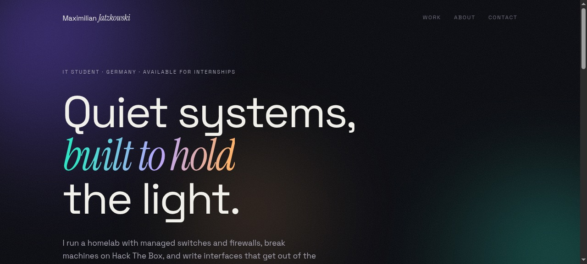

<div align="center">
  
</div>

<h1 align="center">Aurora</h1>

<p align="center"><em>A portfolio with atmosphere.</em></p>

<p align="center">
  <a href="https://noxwer-beep.github.io/aurora/">Live</a> ·
  <a href="https://noxwer-beep.github.io/showcase/">All eight concepts</a> ·
  <a href="https://noxwer-beep.github.io/portfolio/">Portfolio</a>
</p>

---

Most dark pages are a black rectangle with white text. I wanted some atmosphere — light
that moves as you scroll — with the type staying still, so the movement reads as
background and not as decoration.

## What is in here

```
index.html   structure and the gradient layers
style.css    the atmosphere: radial gradients, blend modes, soft edges
main.js      scroll-driven parallax, throttled to animation frames
css/         self-hosted fonts (Space Grotesk, Fraunces, DM Mono)
```

Three files, no framework, no build step.

## Run it

```bash
python3 -m http.server 8000
# http://localhost:8000
```

## What it demonstrates

- **`mix-blend-mode: overlay` on a slow radial gradient.** The light builds up instead
  of sitting on top of the text.
- **`backdrop-filter` on the glass chips and cards** marks them as a layer over the
  gradient rather than a flat panel on it.
- **Scroll parallax throttled through `requestAnimationFrame`**, and off entirely
  under `prefers-reduced-motion`.

## Related

- [showcase](https://github.com/Noxwer-beep/showcase) — the gallery and design notes
- [portfolio](https://github.com/Noxwer-beep/portfolio) — the real site

MIT.
